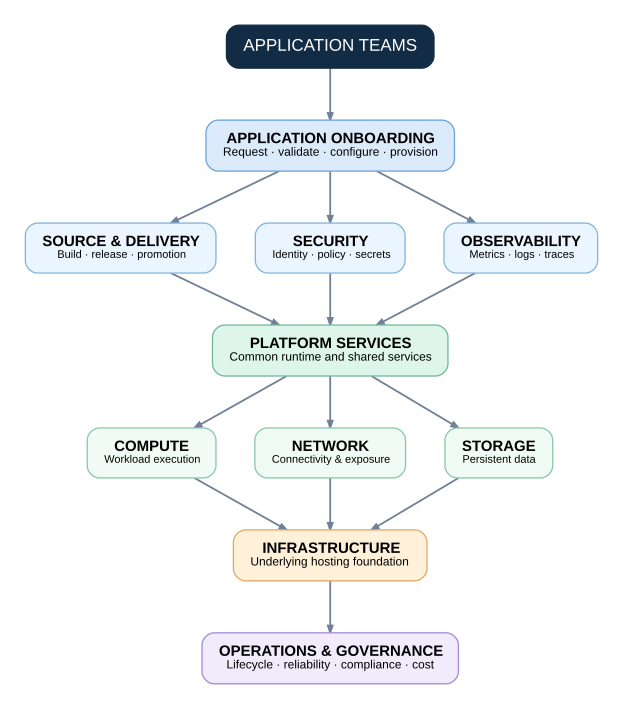

# Platform Capability Model

The platform architecture is organized around capabilities rather than
individual infrastructure products.

A capability describes what the platform must provide.

An implementation describes how that capability is delivered.

---

## High-Level Capability Model

