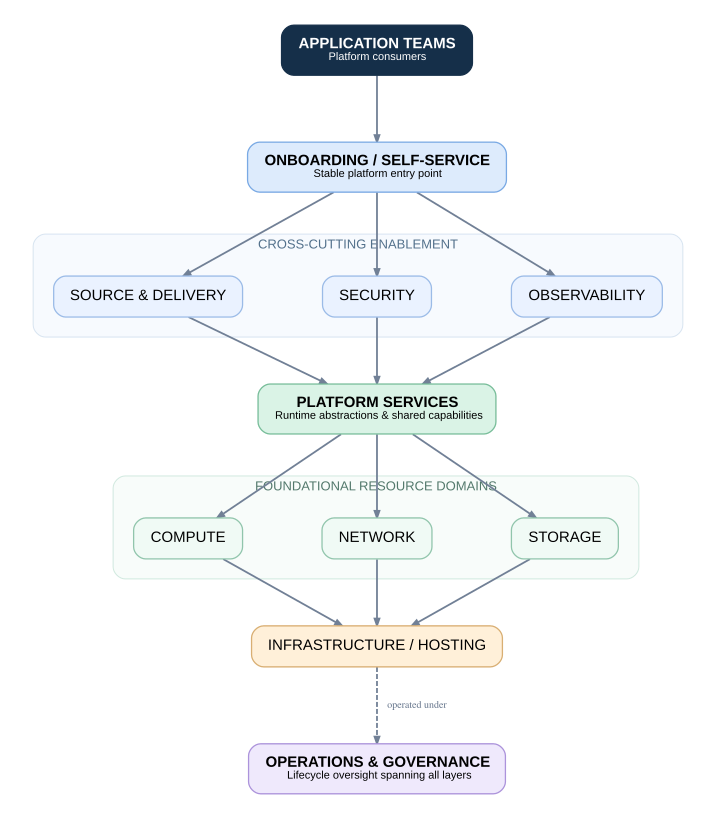

# HLD-001: Enterprise Platform Reference Architecture

**Status:** Draft  
**Version:** 0.1  
**Architecture Phase:** A01 - Architecture Foundation

---

# 1. Executive Summary

This document describes the initial high-level architecture for a long-lived
enterprise platform intended to support microservices workloads.

The architecture is technology-neutral.

Its purpose is to define stable capabilities, architectural boundaries and
operating principles before implementation products are selected.

The platform is expected to evolve over a lifecycle of up to approximately ten
years.

Technology replacement is therefore treated as a normal lifecycle event rather
than an exceptional redesign.

---

# 2. Architecture Context

An organization is modernizing workloads from traditional monolithic deployment
models toward microservices.

Application teams require a standardized platform through which workloads can
be:

- onboarded
- built
- deployed
- secured
- observed
- scaled
- recovered
- operated

The platform architecture does not define application business logic or
application decomposition.

---

# 3. Goals

The platform architecture should:

1. provide standardized application onboarding;
2. provide repeatable software delivery capabilities;
3. enforce platform security controls;
4. provide clear workload and team isolation;
5. provide identity and secrets capabilities;
6. provide platform and workload observability;
7. support reliability and recovery;
8. provide operational and audit evidence;
9. reduce application dependency on individual platform products;
10. support replacement of implementation components over time.

---

# 4. Non-Goals

The architecture does not attempt to:

- design application business functionality;
- define how monolithic applications are decomposed;
- mandate a specific Kubernetes distribution;
- mandate a specific CI/CD system;
- mandate a specific GitOps controller;
- mandate a specific observability platform;
- mandate a specific cloud provider during the architecture foundation phase.

---

# 5. Design Horizon

The platform is designed with a lifecycle of up to approximately ten years.

During this period, implementation technologies are expected to change.

The architecture therefore separates:

1. platform capabilities;
2. architectural contracts;
3. implementation components.

---

# 6. Architecture Principles

The architecture follows the principles documented in:

`docs/architecture/02-principles.md`

Major principles include:

- capability before product;
- platform as a product;
- standardized paved roads;
- clear responsibility boundaries;
- build once and promote the same artifact;
- declarative desired state;
- security by default;
- least privilege;
- observability by default;
- design for failure and recovery;
- auditability;
- operability;
- automation;
- reduced implementation coupling;
- component replaceability.

---

# 7. Platform Capability Model

The platform capability model consists of the following major domains:

1. Application Onboarding
2. Source and Software Delivery
3. Runtime Platform
4. Networking
5. Storage and Data Protection
6. Identity and Secrets
7. Security
8. Observability
9. Reliability
10. Operations and Governance

Detailed capability definitions are maintained in:

`docs/architecture/03-capability-model.md`

---

# 8. Logical Architecture

---

## 9. Capability-Driven Technology Selection

The enterprise platform architecture defines required capabilities before selecting the products used to implement them.

### 9.1 Capability Domains

The platform consists of eight major capability domains:

1. Workload runtime
2. Tenancy and isolation
3. Build and verification
4. Artifact management
5. Deployment and reconciliation
6. Identity, security and policy
7. Observability and reliability
8. Operations and lifecycle

Each domain has identifiable responsibilities, requirements and operational dependencies.

### 9.2 Selection Methodology

Technology evaluation follows this order:

1. Confirm business and workload requirements.
2. Derive architectural capabilities.
3. Apply mandatory organizational constraints.
4. Identify viable implementation options.
5. Evaluate candidates using documented criteria.
6. Assess operational risks and lifecycle costs.
7. Perform sensitivity analysis.
8. Record an architecture decision.
9. Obtain the required organizational approval.

### 9.3 Separation of Responsibilities

Continuous integration, artifact management, deployment reconciliation and workload execution are separate architectural capabilities.

They may be provided by different products or by an integrated product suite.

Their responsibilities must remain distinguishable in the architecture.

### 9.4 Technology Independence

The HLD does not mandate:

- A specific Kubernetes distribution
- OpenShift
- A specific CI system
- Argo CD or Flux
- A particular cloud provider

Such products may implement defined capabilities following a separate evaluation.

### 9.5 Selected Architectural Approach

ADR-002 establishes capability-driven technology selection as the reference architecture decision method.

No final vendor or product selection is made in A02.

### 9.6 Evidence

- [Capability Catalog](../architecture/04-capability-catalog.md)
- [Requirements](../architecture/05-platform-requirements.md)
- [Technology Evaluation](../architecture/06-technology-evaluation.md)
- [ADR-002](../adr/ADR-002-technology-selection.md)
- [Architecture Evidence](../../evidence/A02.md)
